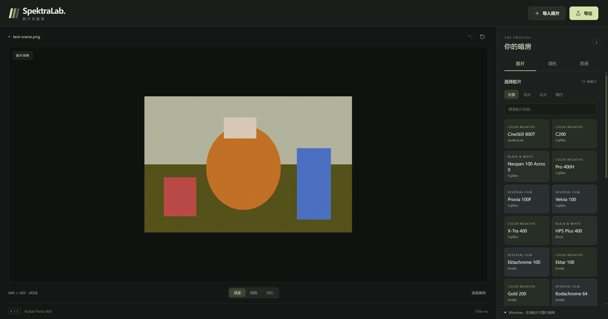
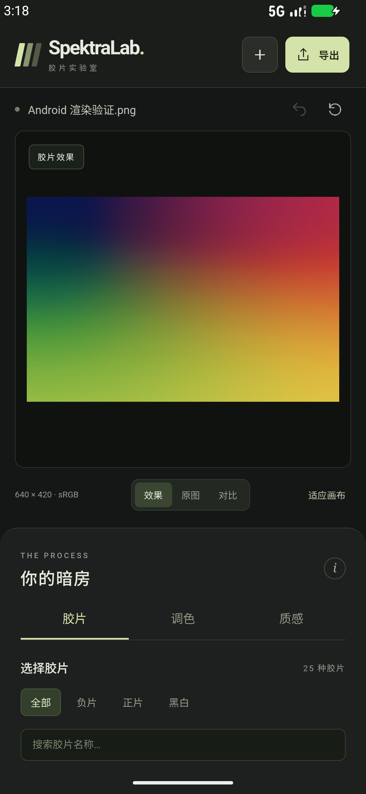

# SpektraLab CrossPlatform

面向 **Windows 和 Android** 的本地胶片模拟应用。深色橄榄灰界面、浅绿色按钮，两端共用同一套 UI；Windows 使用侧边调节栏，手机使用下方调节面板。

基于 [JamesQiu2005/SpektraLab](https://github.com/JamesQiu2005/SpektraLab) 的 `Windows_Linux` 分支，保留原生 C++ / Vulkan 模型与原始配置数据。这是独立的社区移植版，不是上游官方发行版。

**[下载安装包](https://github.com/Godoshi9/SpektraLab-CrossPlatform/releases/latest)** · [构建说明](crossplatform/README.md) · [验证记录](crossplatform/docs/VALIDATION.md)

## 使用

1. 导入 JPEG、PNG 或受 LibRaw 支持的相机 RAW。
2. 选择胶片与相纸，调整照片明暗、胶片曝光、印相色温和色调。
3. 按需调整颗粒、光晕、相纸辉光和胶片画幅。
4. 使用原图 / 效果 / 分割对比查看变化，导出 PNG 或 JPEG。

包含 **25 款胶片、9 款相纸**，包括彩色负片、正片、黑白与 CineStill 800T。照片在本机处理，不需要登录或上传。导入或渲染失败会保留上一张可用图像。

Windows 快捷键：`Ctrl+O` 导入，`Ctrl+E` 导出，`Ctrl+Z` 撤销，按住空格查看原图。界面提供重置、胶片搜索和 100% 查看。

## 安装

| 平台 | 文件 | 要求 |
|---|---|---|
| Windows | `SpektraLab-0.1.0-Windows-x64-Setup.exe` | Windows 10 1903+ / Windows 11，x64，Vulkan 显卡驱动，Microsoft Edge WebView2 Runtime |
| Windows 免安装 | `SpektraLab-0.1.0-Windows-x64-Portable.zip` | 解压完整文件夹，运行 `SpektraLab.exe`；不要单独移动 exe |
| Android | `SpektraLab-0.1.0-Android.apk` | Android 9+、ARM64；也包含 x86_64 库；需要可用的 Vulkan compute 驱动 |

Windows 包含 .NET 8.0.33 运行时。Android 使用系统文件选择器，无需整个存储空间的访问权限。APK 使用项目独立发布密钥签名；Windows 安装包未做商业代码签名。

## 当前版本范围

这是 **0.1.0 首个可运行版本**，实现单张照片的核心编辑流程，并非 macOS 应用全部功能的移植。

- 输出为 **sRGB、8-bit PNG/JPEG**。工作图像最长边上限：Windows **4096 px**，Android **2048 px**。较大图像导入时缩小，界面显示实际导出尺寸。RAW 解码仍可能占用较多内存。
- 尚无批量图库、项目持久化、裁切、曲线、Film Edge、Date Back、HDR 或 16-bit 导出界面。撤销记录仅保存在本次会话中。
- RAW 使用 LibRaw 0.22.2 兼容解码路径；Nikon HE/HE* 不支持。未对全部相机格式和手机 GPU 做实机验证。
- Android 已在 x86_64 模拟器完成真实原生渲染与导出验证。ARM64 包已交叉编译并校验签名，需要具体手机上的兼容性测试。
- sRGB 预览不等同于 macOS ColorSync / HDR 显示链的色彩验证；导出不携带源 EXIF。

## 界面

以下来自运行中的应用，使用合成测试图检验渲染、方向与导出，不是产品照片效果示例。

## 代码

- `crossplatform/ui/`：两端直接打包的共享 HTML/CSS/JavaScript，无远程页面、CDN 或 Node 运行时。
- `crossplatform/native/`：连接上游引擎的 C ABI / JNI，串行工作队列。
- `crossplatform/windows/`：WinForms + WebView2 外壳、文件对话框、图片编码和安装器定义。
- `crossplatform/android/`：Java + 系统 WebView、Storage Access Framework、图片编解码。
- `engine/`：上游胶片模型、Vulkan 后端、LibRaw 与配置数据。
- `modern_UI/`、`windows_UI/`、`desktop/`：保留的上游实现，本版本不通过这些前端启动。

## 署名与许可证

基线：`a46627d250545a394ca21522f8a28b0fb89e4c42`（`Windows_Linux`），保留上游 Git 历史、许可证与原始数据。

- SpektraLab 应用 / 引擎：JamesQiu2005 / Hanze Qiu，**GPL-3.0-or-later**。
- 胶片模型、原始胶片 / 相纸资料和 print LUT：Andrea Volpato / [spektrafilm](https://github.com/andreavolpato/spektrafilm)，资料为 **CC BY-SA 4.0**。
- 跨平台外壳和界面修改：本仓库，**GPL-3.0-or-later**。
- LibRaw：LGPL-2.1；volk：MIT。字体、WebView2、运行时等完整许可证随安装包附带，可在「关于 → 查看开源许可证」查看。

见 [LICENSE.txt](LICENSE.txt)、[license/](license/) 和 [上游资料声明](engine/resources_product/NOTICE.md)。原始 macOS 介绍可在 [上游仓库](https://github.com/JamesQiu2005/SpektraLab) 阅读。
