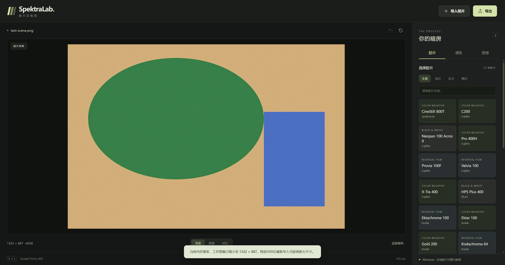

# 验证记录

## Windows 0.1.1 — 2026-10-31

- 在用户主机复现 0.1.0：剩余系统 commit 约 2.3 GiB 时，640 × 420 自测也在 Vulkan 数学探针分配阶段被固定 3 GiB 余量拦截。
- 修改仅为宿主内存预算、闲置缓存回收、工作尺寸及错误恢复；胶片数据、模型、float32 精度、数学探针和效果配置保持不变。
- 新增预算边界测试：2.5 GiB 可用 commit 接受小图；1 GiB 以下拒绝、整数减法无下溢、正常内存保留 4096 上限。原生回归还强制提高 reserve，验证失败导入保留旧图与尺寸、恢复后重试像素一致。
- 32 项原生测试全部通过。首次完整运行中 transfer 压力测试触发内存保护；回收本项目已经空闲的 Gradle 编译守护进程后，该项单独重跑通过。没有关闭用户应用或修改系统分页文件。
- Windows 应用自测：640 × 420 原生渲染、PNG 逐像素一致、JPEG 可解码均通过。
- 0.1.1 安装器：独立目录安装、安装后真实渲染与 PNG / JPEG 自测、卸载均通过。
- 4096 × 2730 合成大图连续导入三次，按照当时内存分别得到 1117 × 744、981 × 653、978 × 651 的工作图像；三次 PNG 解码均与原生预览逐像素一致，失败导入均保留先前结果。这些尺寸是当时环境的观测值，并非固定降采样规格。
- 实际 WebView2 大图导入、调节、分割对比和 390 CSS px 布局通过；工作图像为 1332 × 887，界面明确显示内存缩图提示。

Android 发布包未更换，仍使用下方 0.1.0 的验证记录。未新增真实相机 RAW 样本、ARM64 真机或 macOS / Python parity 验证。

## 0.1.0

日期：2026-10-31。基线：`Windows_Linux` / `a46627d250545a394ca21522f8a28b0fb89e4c42`。

| 检查 | 结果 |
|---|---|
| Windows MSVC Release | 成功 |
| 上游原生测试与 bridge 测试 | 31 / 31 通过，约 70 秒；不是 macOS XCTest |
| bridge 最终增量测试 | 通过，包括继承型胶片目录、sRGB、编辑、失败保留旧图、正片 |
| Windows 应用 self-test | 真实 Vulkan；PNG 与预览逐像素一致，JPEG 可解码且尺寸一致 |
| Windows 安装器 | 静默安装到独立测试目录，安装后的程序完成真实 Vulkan / PNG / JPEG 自测，随后正常卸载 |
| WebView2 UI self-test | 导入、明暗调节、分割对比通过；390 CSS px 布局无横向溢出 |
| Android ARM64 / x86_64 native 库 | NDK 30 / API 28，Release 构建成功 |
| Android Debug APK | Android 17 x86_64 模拟器安装、启动、JNI / Vulkan 渲染成功 |
| Android 图像自测 | 原图像素一致；明暗调节有效；恢复参数一致；PNG 解码逐像素一致 |
| Android Release APK | APK v2 签名验证通过、16 KiB ZIP 对齐检查通过；模拟器安装和启动成功，release 不可调试 |
| 最终应用引擎目录 | 使用上游 profile loader 解析继承配置，25 款胶片 / 9 款相纸 |

使用确定性合成图像。数学探针保持启用，失败时不会偷偷换为近似滤镜。0.1.0 保留上游 3 GiB 提交内存预算检查；当时测试关闭本次启动的 Android 模拟器，避免和桌面测试争用内存。0.1.1 已修正跨平台宿主的内存策略，见上文。

未验证：ARM64 真机及各手机 GPU、真实相机 RAW 样本矩阵、Python / Metal 全图 parity、HDR / 广色域显示校准。该仓库不含上游相机素材，也没有在此 Windows 主机运行 macOS XCTest。RAW 错误路径和链接验证不能证明全部相机格式正确。

模拟器截图与 WebView2 捕获只证明各自表面的绘制，不证明真机 GPU 或显示器 ICC 行为。完整限制见根 README。安装包旁提供 SHA-256 清单。
